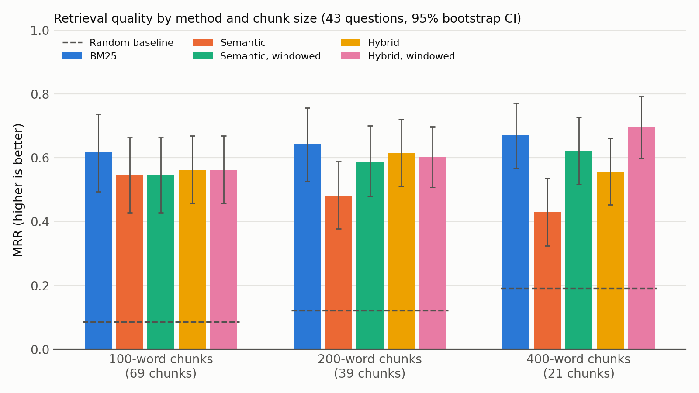
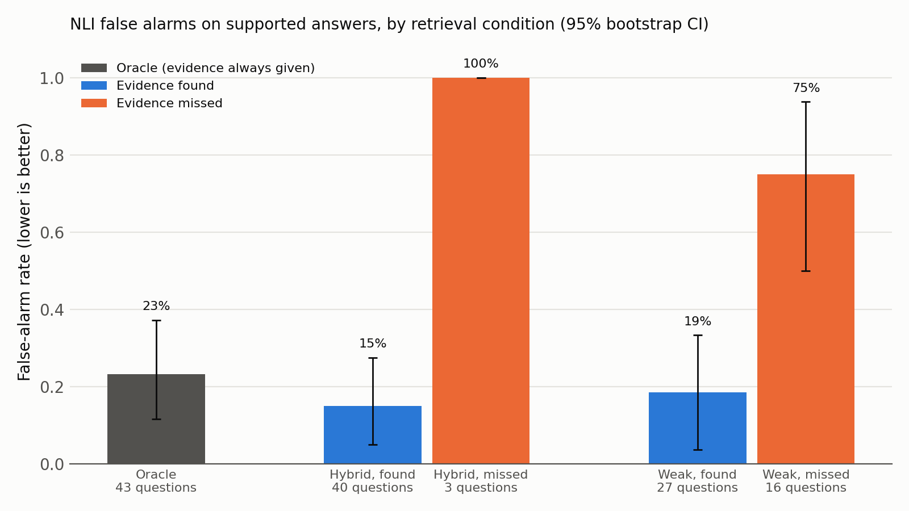

# PDF Question Answering: BM25 vs Semantic vs Hybrid Retrieval

A small research project on the **retrieval** step of PDF question answering (RAG). Given a question about a PDF, which method finds the passage that answers it best? I compare keyword search (BM25), semantic search (sentence embeddings + FAISS) and a hybrid of both, at three chunk sizes, on a labelled evaluation set of 43 questions.

**Full write-up: [REPORT.md](REPORT.md)**



## Key results (43 questions about the Sentence-BERT paper)

- **BM25 is a strong baseline.** It beat plain semantic search at every chunk size (significantly at 200 and 400 words).
- **The embedding model's 256-token limit silently cut off most chunks.** As a result, semantic search got *worse* with bigger chunks.
- **Embedding chunks as windows of ≤ 180 words fixes most of this.** The best configuration, windowed hybrid with 400-word chunks, reaches **MRR 0.70 and Recall@5 0.90**.
- Evaluation set: **43 questions (15 written by me, 28 LLM-drafted), each labelled with evidence quotes**. Results are reported for both groups. See the report for limitations.

## Part 2: Can we catch unsupported answers?

Given an answer and the retrieved text, can an automatic checker tell whether the answer is supported by that text? I tested word overlap and an NLI model (`cross-encoder/nli-deberta-v3-base`, run on 3-sentence windows) on 129 answers: 43 supported, 43 contradicted and 43 unsupported. 15 answers were written by me and 114 were drafted by an LLM. I reviewed all of them.

- **With perfect retrieval, NLI separates good answers from bad ones well.** Its AUROC is 0.90, significantly better than word overlap (0.81).
- **The checker depends on retrieval.** NLI AUROC falls to 0.85 with hybrid retrieval and 0.74 with weak retrieval.
- **Most false alarms come from missed evidence.** NLI rejects 19% of supported answers when weak retrieval found the evidence, but 75% when it missed it (16 questions).



## How it works

| File | What it does |
|---|---|
| `pipeline.py` | All logic: PDF extraction and cleaning, chunking, BM25 (hand-written), semantic search (all-MiniLM-L6-v2 + FAISS, optional windowing), hybrid search (Reciprocal Rank Fusion), metrics (P@k, R@k, MRR), bootstrap confidence intervals |
| `App.py` | Streamlit app: upload a PDF and search it with Keyword / BM25 / Semantic / Hybrid |
| `eval/questions.json` | 43 labeled questions. Each has evidence quotes (page + exact text), a type (lexical / paraphrase) and an author (`llm` / `human`) |
| `check_eval_set.py` | Checks that every evidence quote is found in the PDF |
| `evaluate.py` | Stage 4 report: semantic search vs a random baseline |
| `experiments.py` | All experiments (5 methods × 3 chunk sizes) with paired bootstrap tests. Writes `results/*.csv` |
| `make_chart.py` | Draws `results/chart.png` from the results |
| `verification/faithfulness_set.json` | Part 2 test set: 129 answers (supported / contradicted / unsupported), each recording who drafted it and whether I edited it |
| `verification/review_log.md` | My review decision for every answer in the test set |
| `verification/draft_answers.py` | Writes the first draft of the test set |
| `verification/check_set.py` | Checks the test set (counts per label, empty or unchecked items) |
| `verification/build_contexts.py` | Builds the three context conditions (oracle, hybrid, weak). Writes `verification/contexts.json` |
| `verification/detect.py` | Scores every answer with overlap and NLI in each condition. Writes `verification/scores.csv` |
| `verification/run_verification.py` | Metrics with bootstrap CIs, the chart and error cases. Writes `results/verification/` |

## Run it

```bash
pip install -r requirements.txt

# The test paper is not included in the repo. Download Sentence-BERT (arXiv:1908.10084):
curl -L -o test.pdf https://arxiv.org/pdf/1908.10084v1

python check_eval_set.py   # verify the labels match the PDF
python experiments.py      # run all experiments (writes results/)
python make_chart.py       # redraw the chart
streamlit run App.py       # interactive search app

# Part 2
python verification/build_contexts.py     # build the three context conditions
python verification/detect.py             # score every answer with overlap and NLI
python verification/run_verification.py   # metrics, CIs and chart (writes results/verification/)
```

The labels are exact quotes, so the PDF text extraction must match. If you get a "quote not found" error, check that you downloaded the original arXiv v1 PDF.

## Built with

Python, PyMuPDF, sentence-transformers, FAISS, Streamlit, matplotlib. The code was written with an AI coding assistant under my direction. The research question, experiment design decisions, 15 of the evaluation questions and the analysis of the results are my own.
