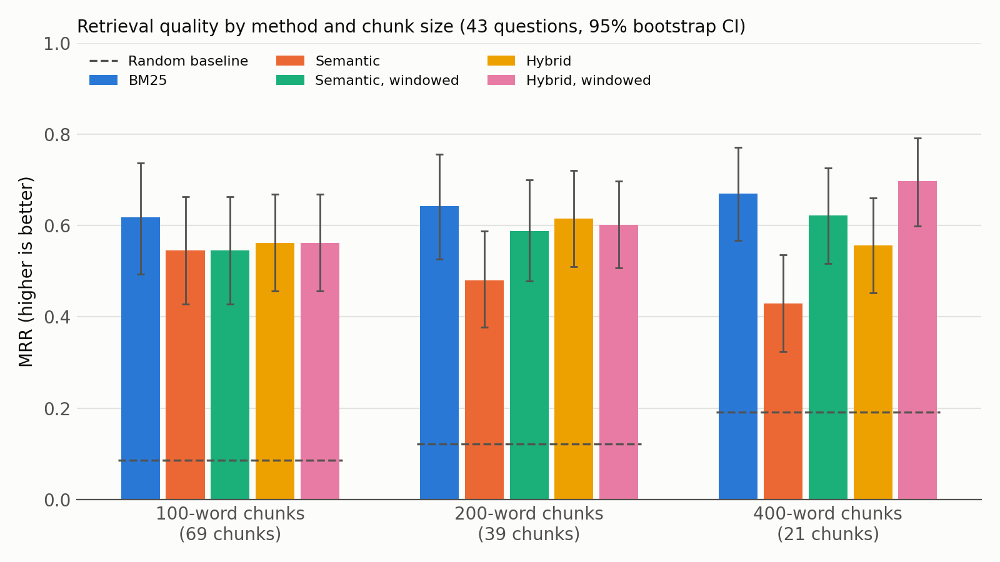

# Keyword, Semantic or Hybrid? Measuring Retrieval for PDF Question Answering

*Harvik Patel — research project, October 2026*

## 1. Research question

A retrieval-augmented (RAG) question-answering system can only answer well if its retriever finds the right passage first. I built a small PDF question-answering retriever and asked:

> **For questions about a scientific paper, how do keyword search (BM25), semantic search (sentence embeddings) and a hybrid of the two compare, and how does chunk size change the answer?**

While running the experiments I found that the embedding model silently cuts off long chunks. That led to a second question: **how much of semantic search's weakness comes from this input limit, and does embedding chunks in shorter windows fix it?**

## 2. Setup

**Document.** *Sentence-BERT* (Reimers & Gurevych, 2019, arXiv:1908.10084), a 9-page paper with prose, tables, math and references. The text is extracted with PyMuPDF, normalized with Unicode NFKC (to fix ligatures like "fi"), and words broken across lines are rejoined.

**Chunking.** Each page is split into chunks of **100, 200 or 400 words** (69, 39 and 21 chunks).

**Retrieval methods.**

| Method | How it ranks chunks |
|---|---|
| BM25 | Implemented by hand (k1 = 1.5, b = 0.75): rare shared words count most, long chunks are slightly penalized |
| Semantic | `all-MiniLM-L6-v2` embeddings, cosine similarity with a FAISS inner-product index |
| Hybrid | Reciprocal Rank Fusion of BM25 and semantic: score = Σ 1 / (60 + rank) |
| Semantic, windowed | Each chunk is embedded as equal windows of ≤ 180 words; the chunk's score is its best window's score |
| Hybrid, windowed | RRF of BM25 and windowed semantic |

**Evaluation set.** 43 questions about the paper. Each is labeled with one or more **evidence quotes** (page + exact text) instead of chunk numbers, so the same labels work for every chunk size. A chunk counts as relevant if it overlaps an evidence quote. Every quote is automatically checked to appear in the extracted text.

- **Authorship:** **28 questions were drafted by an LLM (Claude)** before any search was run on them. **15 were written by me** after reading the paper. Each question records its author (`source` field), and results are reported for both groups. The LLM made two small edits to my questions (re-tagging two question types), and these are marked in the data.
- Each question is tagged *lexical* (it shares a distinctive word with its evidence, 24 questions) or *paraphrase* (it doesn't, 19 questions).

**Metrics.**
- Precision@k, Recall@k (k = 1, 3, 5) and **Mean Reciprocal Rank (MRR)**, computed over the full ranking of all chunks.
- A **random-ranking baseline** (averaged over 200 shuffles) for each chunk size.
- Uncertainty is shown with **95% bootstrap confidence intervals** (10,000 resamples of the questions).
- Methods are compared with **paired** bootstraps of the per-question difference in reciprocal rank. A difference is called significant when its 95% CI excludes 0.

## 3. Results

| Chunk size | Method | MRR [95% CI] | R@1 | R@5 | MRR lexical | MRR paraphrase |
|---|---|---|---|---|---|---|
| 100 | random | 0.086 | 0.01 | 0.08 | | |
| 100 | BM25 | **0.618** [0.49, 0.74] | 0.43 | 0.69 | 0.766 | 0.432 |
| 100 | Semantic | 0.545 [0.43, 0.66] | 0.36 | 0.66 | 0.618 | 0.454 |
| 100 | Hybrid | 0.563 [0.46, 0.67] | 0.30 | **0.74** | 0.647 | 0.456 |
| 200 | random | 0.122 | 0.03 | 0.13 | | |
| 200 | BM25 | **0.642** [0.53, 0.76] | 0.46 | 0.72 | 0.765 | 0.488 |
| 200 | Semantic | 0.479 [0.38, 0.59] | 0.27 | 0.66 | 0.506 | 0.446 |
| 200 | Hybrid | 0.615 [0.51, 0.72] | 0.39 | 0.84 | 0.639 | **0.585** |
| 200 | Semantic, windowed | 0.588 [0.48, 0.70] | 0.41 | 0.80 | 0.666 | 0.491 |
| 200 | Hybrid, windowed | 0.601 [0.51, 0.70] | 0.33 | **0.86** | 0.660 | 0.528 |
| 400 | random | 0.192 | 0.05 | 0.24 | | |
| 400 | BM25 | 0.669 [0.57, 0.77] | 0.47 | 0.83 | **0.767** | 0.546 |
| 400 | Semantic | 0.429 [0.32, 0.54] | 0.23 | 0.59 | 0.391 | 0.477 |
| 400 | Hybrid | 0.556 [0.45, 0.66] | 0.32 | 0.76 | 0.573 | 0.535 |
| 400 | Semantic, windowed | 0.622 [0.52, 0.73] | 0.44 | 0.84 | 0.668 | 0.564 |
| 400 | Hybrid, windowed | **0.698** [0.60, 0.79] | **0.50** | **0.90** | 0.717 | **0.673** |

At 100 words no chunk needs splitting, so the windowed methods are identical to the plain ones there and are left out of the table.

**Paired comparisons (difference in MRR, 95% CI):**

| Comparison | 200 words | 400 words |
|---|---|---|
| Semantic − BM25 | −0.163 [−0.31, −0.02] ✓ | −0.241 [−0.39, −0.09] ✓ |
| Hybrid − Semantic | +0.136 [+0.05, +0.22] ✓ | +0.127 [+0.05, +0.21] ✓ |
| Semantic windowed − Semantic | +0.109 [−0.00, +0.22] | +0.193 [+0.04, +0.35] ✓ |
| Hybrid windowed − Hybrid | −0.014 [−0.10, +0.08] | +0.142 [+0.02, +0.27] ✓ |
| Hybrid windowed − BM25 | −0.041 [−0.15, +0.07] | +0.028 [−0.09, +0.14] |

✓ = significant. At 100 words none of the BM25 / semantic / hybrid differences is significant.

## 4. Findings

1. **BM25 is a strong baseline that is hard to beat.** It had the highest MRR of the three original methods at every chunk size. Its lead over semantic search is significant at 200 and 400 words, but not at 100. For this document and these questions, exact word overlap is a very good signal.

2. **Semantic search was limited by its input length, not only by its idea of "meaning."** `all-MiniLM-L6-v2` reads at most 256 tokens and silently drops the rest. 29 of 39 chunks (200 words) and 19 of 21 (400 words) are longer than that. In some failures the answer sits entirely in the dropped part. For example, the evidence for "How many sentence pairs does SNLI contain?" starts at token 380 of its chunk. This is why plain semantic search *gets worse* as chunks get bigger (0.545 → 0.479 → 0.429), while BM25, which reads everything, gets better.

3. **Embedding shorter windows fixes most of this.** With windows of ≤ 180 words, semantic search no longer degrades with chunk size (0.545 → 0.588 → 0.622). The gain at 400 words is significant (+0.193). The best configuration overall is **windowed hybrid with 400-word chunks**: MRR 0.698 and Recall@5 0.90, so the right passage is in the top 5 for 9 of 10 questions. Its advantage over BM25 is *not* significant (+0.028), so the honest conclusion is that it is *at least as good as BM25 and finds the answer in the top 5 more often*, not that it beats BM25.

4. **Hybrid search helps most where semantic search is weak, and on paraphrased questions.** BM25 drops from 0.77 MRR on lexical questions to 0.43–0.55 on paraphrase questions. Windowed hybrid at 400 words is the most balanced (0.717 lexical, 0.673 paraphrase). For RAG, where an LLM reads all top-k chunks, the higher Recall@5 of hybrid methods matters more than a slightly lower MRR.

5. **Who wrote the question matters a little.** At 200 words BM25 scores 0.72 MRR on my 15 questions vs 0.60 on the 28 LLM questions. 10 of my 15 questions are lexical, because I tended to reuse the paper's wording after reading it. With 15 questions this is a hint, not a result.

## 5. Limitations

- **One document and 43 questions.** The confidence intervals are wide (about ±0.11 MRR), and the results may not transfer to other documents, domains or languages.
- **Question bias toward BM25.** Every question was written by someone (or something) that had just read the paper, so even "paraphrase" questions reuse its vocabulary. Real users who haven't read the document would probably favour semantic and hybrid search more.
- **Mostly LLM-drafted questions.** 28 of 43 questions were written by an LLM. Their wording may differ from how people ask. I report results by author for this reason.
- **Comparing chunk sizes is not fully fair.** Fewer chunks make even random ranking better (random MRR 0.086 → 0.192), and top-5 at 400 words returns 2,000 words of text versus 500 at 100 words. Comparisons *between methods at the same chunk size* are the fair ones.
- **Windowing doesn't remove all truncation.** Tables, math and the reference list need 2–3 tokens per word, so 13 of 49 windows at 400 words are still longer than 256 tokens. Splitting by token count instead of word count would fix this.
- **No tuning.** BM25 (k1, b), the RRF constant (60) and the window size were set to standard values, not tuned. Tuning on 43 questions would overfit.
- **Retrieval only.** I measured whether the right passage is found, not whether an LLM then produces a correct answer.

## 6. What I would do next

Split windows by token count, test on several papers with questions from people who haven't read them, compare a larger or longer-input embedding model, and evaluate full answers with an LLM in the loop.

- Test a long-context embedding model, to separate truncation (text never seen) from dilution (one vector blurring a long chunk).

## Reproducibility

All code is in this repository:
- `pipeline.py`: extraction, chunking, BM25, semantic, hybrid, metrics, bootstrap.
- `experiments.py`: runs every configuration and writes `results/summary.csv` and `results/per_question.csv`.
- `make_chart.py`: draws the chart.

The code was written with an AI coding assistant (Claude Code) under my direction. I reviewed it and can explain every part.
